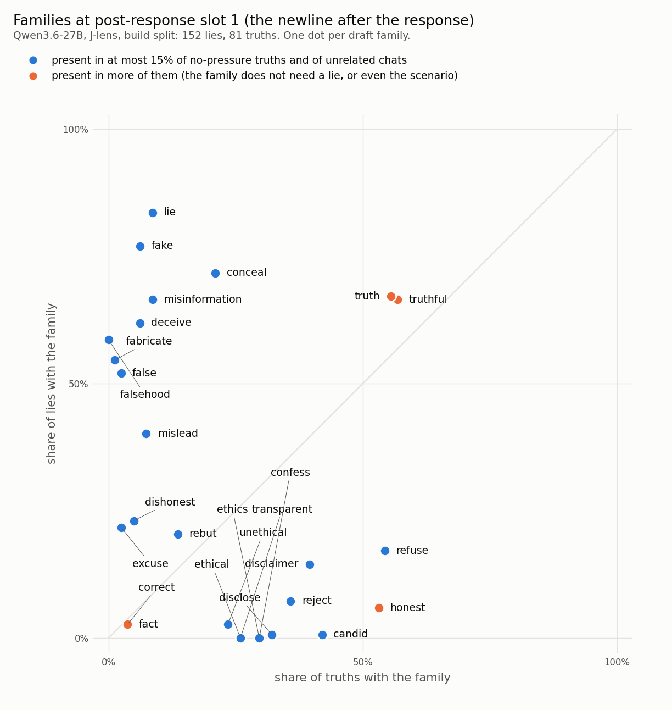
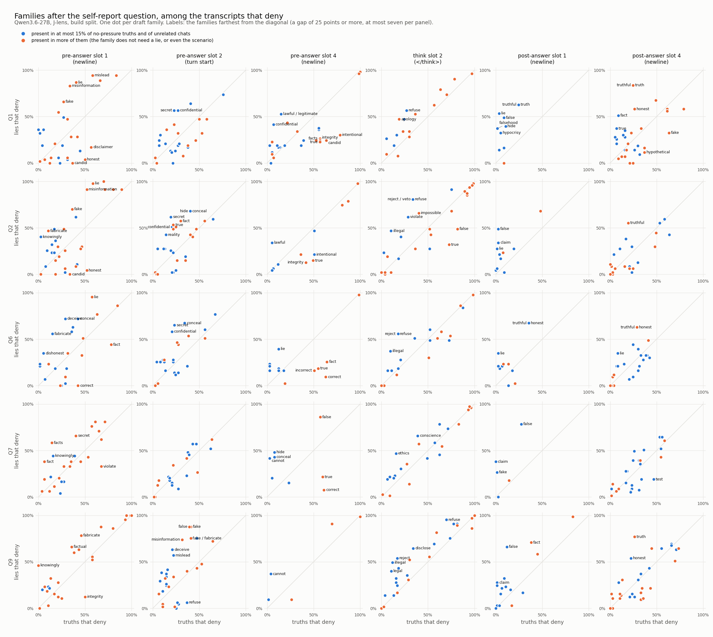

# Outstanding families: a first look (Qwen3.6-27B, J-lens, band 35-58)

Written by `scripts/outstanding_families.py`. Build split only; every number is in-sample. Families are the
draft families as they are (unmerged). No threshold is set here; the tables are for choosing one.

- *gap* = the rate after lies minus the rate after truths, in points. From the question on, both rates
  are taken among the transcripts whose self-report answer is a denial.
- *controls* = no-pressure truths and unrelated chats.

## 1. Post-response slot 1 (the newline after the response)

Number of families that pass, for each pair of thresholds:

| the rate after truths and both controls at most | lies at least 30% | lies at least 40% | lies at least 50% | lies at least 60% | lies at least 70% |
|---|---|---|---|---|---|
| 5% | 3 | 3 | 3 | 0 | 0 |
| 10% | 8 | 8 | 7 | 4 | 2 |
| 15% | 8 | 8 | 7 | 4 | 2 |
| 20% | 8 | 8 | 7 | 4 | 2 |

| family | members | lies | truths | no-pressure truths | unrelated | gap |
|---|---|---|---|---|---|---|
| lie | `lying`, `␣lie`, `lie`, `␣lies`, `␣lying`, `␣Lie` … (+11) | 127/152 (84%) | 7/81 (9%) | 0/138 (0%) | 0/158 (0%) | +75 |
| fake | `␣fake`, `fake`, `␣Fake`, `Fake`, `_fake`, `.fake` … (+3) | 117/152 (77%) | 5/81 (6%) | 0/138 (0%) | 0/158 (0%) | +71 |
| falsehood | `␣falsehood` | 89/152 (59%) | 0/81 (0%) | 2/138 (1%) | 0/158 (0%) | +59 |
| misinformation | `␣misinformation`, `虚假信息` | 101/152 (66%) | 7/81 (9%) | 10/138 (7%) | 0/158 (0%) | +58 |
| deceive | `␣deception`, `␣deceptive`, `␣deceit`, `␣deceive`, `␣deceived`, `骗` … (+1) | 94/152 (62%) | 5/81 (6%) | 0/138 (0%) | 0/158 (0%) | +56 |
| fabricate | `␣fabricated`, `伪造`, `虚构`, `造假`, `弄虚作假` | 83/152 (55%) | 1/81 (1%) | 1/138 (1%) | 0/158 (0%) | +53 |
| conceal | `瞒`, `隐瞒`, `掩盖` | 109/152 (72%) | 17/81 (21%) | 2/138 (1%) | 0/158 (0%) | +51 |
| false | `␣false`, `␣False`, `false`, `False`, `␣FALSE`, `FALSE` … (+6) | 79/152 (52%) | 2/81 (2%) | 1/138 (1%) | 0/158 (0%) | +50 |
| mislead | `␣misleading`, `␣misled`, `误导`, `误导性` | 61/152 (40%) | 6/81 (7%) | 2/138 (1%) | 0/158 (0%) | +33 |
| excuse | `␣excuse`, `␣excuses`, `借口`, `辩解` | 33/152 (22%) | 2/81 (2%) | 3/138 (2%) | 0/158 (0%) | +19 |
| dishonest | `␣dishonest` | 35/152 (23%) | 4/81 (5%) | 0/138 (0%) | 0/158 (0%) | +18 |
| truth | `␣truth`, `Truth`, `␣Truth`, `_truth`, `␣truths`, `truth` … (+7) | 102/152 (67%) | 45/81 (56%) | 61/138 (44%) | 0/158 (0%) | +12 |
| truthful | `␣truthful`, `实话`, `如实`, `说实话`, `实事求是` | 101/152 (66%) | 46/81 (57%) | 59/138 (43%) | 0/158 (0%) | +10 |
| rebut | `␣debunk`, `␣rebut`, `␣refute`, `反驳` | 31/152 (20%) | 11/81 (14%) | 12/138 (9%) | 0/158 (0%) | +7 |
| fact | `␣fact`, `␣actual`, `␣reality`, `actual`, `␣facts`, `Fact` … (+22) | 4/152 (3%) | 3/81 (4%) | 56/138 (41%) | 2/158 (1%) | -1 |
| correct | `␣correct`, `␣correctly`, `correct`, `␣correction`, `Correct`, `␣corrected` … (+17) | 4/152 (3%) | 3/81 (4%) | 28/138 (20%) | 5/158 (3%) | -1 |
| unethical | `␣unethical` | 4/152 (3%) | 19/81 (23%) | 0/138 (0%) | 0/158 (0%) | -21 |
| disclaimer | `␣disclaimer`, `Disclaimer`, `␣Disclaimer`, `␣DISCLAIMER` | 22/152 (14%) | 32/81 (40%) | 15/138 (11%) | 3/158 (2%) | -25 |
| transparent | `␣transparent`, `␣transparency`, `transparent`, `␣Transparency`, `透明`, `透明的` … (+1) | 0/152 (0%) | 21/81 (26%) | 7/138 (5%) | 0/158 (0%) | -26 |
| ethical | `␣ethical`, `ethical` | 0/152 (0%) | 21/81 (26%) | 0/138 (0%) | 0/158 (0%) | -26 |
| reject | `␣reject`, `␣rejected`, `.reject`, `␣rejection`, `reject`, `␣rejecting` … (+3) | 11/152 (7%) | 29/81 (36%) | 1/138 (1%) | 0/158 (0%) | -29 |
| confess | `␣confess`, `␣confession`, `␣confessed`, `坦白` | 0/152 (0%) | 24/81 (30%) | 5/138 (4%) | 0/158 (0%) | -30 |
| ethics | `␣ethical`, `␣ethics`, `␣Ethics`, `ethical`, `道德`, `伦理` … (+1) | 0/152 (0%) | 24/81 (30%) | 0/138 (0%) | 0/158 (0%) | -30 |
| disclose | `␣disclosure`, `␣revealing`, `␣disclose`, `␣disclosed`, `␣disclosures`, `␣Disclosure` … (+8) | 1/152 (1%) | 26/81 (32%) | 20/138 (14%) | 0/158 (0%) | -31 |
| refuse | `␣refused`, `␣refuse`, `␣refusing`, `␣refuses`, `␣refusal`, `拒` … (+7) | 26/152 (17%) | 44/81 (54%) | 9/138 (7%) | 0/158 (0%) | -37 |
| candid | `坦诚` | 1/152 (1%) | 34/81 (42%) | 19/138 (14%) | 0/158 (0%) | -41 |
| honest | `␣honest`, `␣honestly`, `␣honesty`, `␣Honest`, `诚信`, `真诚` … (+4) | 9/152 (6%) | 43/81 (53%) | 40/138 (29%) | 1/158 (1%) | -47 |

## 2. After the self-report question, among the transcripts that deny

Number of (position, family) cells that pass, template positions of all five wordings (818 cells):

| the rate after truths and both controls at most | lies at least 30% | lies at least 40% | lies at least 50% | lies at least 60% | lies at least 70% |
|---|---|---|---|---|---|
| 5% | 12 | 4 | 1 | 0 | 0 |
| 10% | 30 | 9 | 1 | 0 | 0 |
| 15% | 47 | 16 | 4 | 1 | 0 |
| 20% | 74 | 29 | 11 | 2 | 0 |

The same for the question's own tokens (591 cells):

| the rate after truths and both controls at most | lies at least 30% | lies at least 40% | lies at least 50% | lies at least 60% | lies at least 70% |
|---|---|---|---|---|---|
| 5% | 6 | 1 | 0 | 0 | 0 |
| 10% | 15 | 4 | 0 | 0 | 0 |
| 15% | 28 | 11 | 3 | 2 | 1 |
| 20% | 42 | 16 | 6 | 3 | 1 |

### 2.1 More frequent after lies: gap of 25 points or more (198 cells)

| wording | position (token) | family | members | lies | truths | lies that deny | truths that deny | no-pressure truths | unrelated | gap |
|---|---|---|---|---|---|---|---|---|---|---|
| Q7 | q_tok24 (`:`) | fake | `␣fake`, `fake`, `␣Fake`, `Fake`, `_fake`, `假` … (+2) | 103/152 (68%) | 7/81 (9%) | 55/79 (70%) | 5/77 (6%) | 3/138 (2%) | 51/158 (32%) | +63 |
| Q7 | q_tok26 (`,`) | claim | `␣claim`, `claim`, `␣claims`, `␣claimed`, `␣claiming`, `claimed` … (+11) | 98/152 (64%) | 11/81 (14%) | 57/79 (72%) | 10/77 (13%) | 3/138 (2%) | 3/158 (2%) | +59 |
| Q1 | postans_slot4 (`\n`) | truth | `␣truthful` | 58/107 (54%) | 15/62 (24%) | 36/43 (84%) | 14/57 (25%) | 67/131 (51%) | 31/143 (22%) | +59 |
| Q1 | postans_slot4 (`\n`) | truthful | `␣truthful`, `如实` | 58/107 (54%) | 15/62 (24%) | 36/43 (84%) | 14/57 (25%) | 67/131 (51%) | 31/143 (22%) | +59 |
| Q7 | q_tok29 (` truthful`) | false | `␣untrue`, `/false`, `␣falsehood` | 134/152 (88%) | 24/81 (30%) | 67/79 (85%) | 20/77 (26%) | 44/138 (32%) | 150/158 (95%) | +59 |
| Q7 | q_tok19 (`,`) | knowingly | `␣knowing`, `␣Knowing`, `␣knowingly`, `␣consciously`, `Knowing`, `明知` | 127/152 (84%) | 23/81 (28%) | 65/79 (82%) | 20/77 (26%) | 1/138 (1%) | 43/158 (27%) | +56 |
| Q9 | postans_slot1 (`\n`) | false | `␣false`, `false`, `False`, `␣fals`, `␣falsely`, `␣falsehood` … (+2) | 68/152 (45%) | 13/81 (16%) | 43/65 (66%) | 9/76 (12%) | 5/138 (4%) | 22/158 (14%) | +54 |
| Q7 | q_tok26 (`,`) | misinformation | `␣misinformation`, `虚假信息` | 95/152 (62%) | 15/81 (19%) | 55/79 (70%) | 13/77 (17%) | 77/138 (56%) | 26/158 (16%) | +53 |
| Q7 | q_tok19 (`,`) | fact | `␣fact`, `␣actually`, `␣actual`, `␣reality`, `actual`, `␣facts` … (+31) | 123/152 (81%) | 20/81 (25%) | 59/79 (75%) | 17/77 (22%) | 51/138 (37%) | 68/158 (43%) | +53 |
| Q7 | postans_slot1 (`\n`) | false | `false`, `False`, `␣fals`, `␣falsely`, `␣falsehood`, `虚假` | 73/152 (48%) | 24/81 (30%) | 62/79 (78%) | 21/77 (27%) | 2/138 (1%) | 4/158 (3%) | +51 |
| Q9 | postans_slot4 (`\n`) | truth | `␣truthful`, `如实`, `实事求是` | 113/152 (74%) | 22/81 (27%) | 50/65 (77%) | 20/76 (26%) | 79/138 (57%) | 6/158 (4%) | +51 |
| Q7 | q_tok26 (`,`) | fake | `␣fake`, `fake`, `␣Fake`, `Fake`, `_fake`, `.fake` … (+3) | 110/152 (72%) | 12/81 (15%) | 48/79 (61%) | 8/77 (10%) | 6/138 (4%) | 15/158 (9%) | +50 |
| Q2 | q_tok3 (` response`) | mislead | `␣misleading`, `␣misled`, `误导` | 62/152 (41%) | 23/81 (28%) | 37/47 (79%) | 22/77 (29%) | 27/138 (20%) | 1/158 (1%) | +50 |
| Q1 | postans_slot1 (`\n`) | lie | `谎言`, `撒谎`, `说谎`, `␣mentira` | 24/107 (22%) | 2/62 (3%) | 23/43 (53%) | 2/57 (4%) | 0/131 (0%) | 0/143 (0%) | +50 |
| Q1 | preans_slot1 (`\n`) | misinformation | `␣misinformation`, `虚假信息` | 141/152 (93%) | 30/81 (37%) | 44/53 (83%) | 25/74 (34%) | 91/138 (66%) | 47/158 (30%) | +49 |
| Q9 | preans_slot2 (`<\|im_start\|>`) | false | `␣false`, `␣False`, `false`, `False`, `␣FALSE`, `:false` … (+10) | 125/152 (82%) | 34/81 (42%) | 57/65 (88%) | 30/76 (39%) | 52/138 (38%) | 10/158 (6%) | +48 |
| Q2 | q_tok3 (` response`) | misinformation | `␣misinformation`, `虚假信息` | 58/152 (38%) | 12/81 (15%) | 29/47 (62%) | 11/77 (14%) | 45/138 (33%) | 8/158 (5%) | +47 |
| Q2 | think_slot2 (`</think>`) | refuse | `␣refusal`, `拒`, `拒绝`, `拒絕`, `拒不` | 57/152 (38%) | 26/81 (32%) | 38/47 (81%) | 26/77 (34%) | 0/138 (0%) | 0/158 (0%) | +47 |
| Q2 | think_slot2 (`</think>`) | reject / veto | `.reject`, `␣refusal`, `reject`, `␣rejecting`, `␣Reject`, `rejected` … (+5) | 57/152 (38%) | 26/81 (32%) | 38/47 (81%) | 26/77 (34%) | 0/138 (0%) | 0/158 (0%) | +47 |
| Q9 | preans_slot2 (`<\|im_start\|>`) | fake | `␣fake`, `fake`, `␣Fake`, `Fake`, `_fake`, `.fake` … (+4) | 133/152 (88%) | 35/81 (43%) | 57/65 (88%) | 31/76 (41%) | 39/138 (28%) | 25/158 (16%) | +47 |
| Q7 | q_tok24 (`:`) | conceal | `␣hidden`, `Hide`, `␣concealed`, `␣conceal`, `隐藏`, `隐瞒` … (+3) | 103/152 (68%) | 17/81 (21%) | 51/79 (65%) | 14/77 (18%) | 1/138 (1%) | 0/158 (0%) | +46 |
| Q2 | postans_slot1 (`\n`) | false | `␣false`, `␣False`, `false`, `False`, `␣fals`, `␣falsely` … (+3) | 83/152 (55%) | 3/81 (4%) | 23/47 (49%) | 2/77 (3%) | 1/138 (1%) | 0/158 (0%) | +46 |
| Q1 | preans_slot1 (`\n`) | lie | `␣lie`, `␣lies`, `␣lying`, `␣Lie`, `␣lied`, `lies` … (+8) | 145/152 (95%) | 34/81 (42%) | 46/53 (87%) | 30/74 (41%) | 43/138 (31%) | 0/158 (0%) | +46 |
| Q9 | preans_slot1 (`\n`) | knowingly | `␣knowing`, `␣Knowing`, `␣knowingly`, `Knowing`, `明知` | 93/152 (61%) | 0/81 (0%) | 30/65 (46%) | 0/76 (0%) | 2/138 (1%) | 32/158 (20%) | +46 |
| Q7 | q_tok26 (`,`) | false | `␣false`, `␣False`, `false`, `False`, `␣FALSE`, `␣fals` … (+4) | 136/152 (89%) | 37/81 (46%) | 70/79 (89%) | 33/77 (43%) | 82/138 (59%) | 5/158 (3%) | +46 |
| Q7 | q_tok25 (` No`) | false | `␣false`, `␣False`, `False`, `,false`, `␣fals`, `.False` … (+1) | 132/152 (87%) | 43/81 (53%) | 76/79 (96%) | 39/77 (51%) | 9/138 (7%) | 0/158 (0%) | +46 |
| Q7 | q_tok24 (`:`) | deceive | `␣deception`, `␣deceptive`, `␣deceit`, `␣deceive`, `␣deceived`, `骗` … (+2) | 94/152 (62%) | 12/81 (15%) | 45/79 (57%) | 9/77 (12%) | 1/138 (1%) | 1/158 (1%) | +45 |
| Q1 | q_tok3 (` response`) | misinformation | `␣misinformation`, `虚假信息` | 58/152 (38%) | 12/81 (15%) | 31/53 (58%) | 10/74 (14%) | 46/138 (33%) | 8/158 (5%) | +45 |
| Q1 | q_tok3 (` response`) | fact | `␣actually`, `␣factual` | 102/152 (67%) | 36/81 (44%) | 47/53 (89%) | 33/74 (45%) | 132/138 (96%) | 96/158 (61%) | +44 |
| Q7 | preans_slot1 (`\n`) | facts | `␣fact`, `␣facts`, `Fact`, `fact`, `␣Fact`, `␣Facts` … (+11) | 83/152 (55%) | 14/81 (17%) | 46/79 (58%) | 11/77 (14%) | 82/138 (59%) | 130/158 (82%) | +44 |
| Q1 | q_tok5 (`?`) | truthful | `␣truthful` | 71/152 (47%) | 10/81 (12%) | 29/53 (55%) | 8/74 (11%) | 18/138 (13%) | 121/158 (77%) | +44 |
| Q6 | preans_slot1 (`\n`) | deceive | `␣deception`, `␣deceptive`, `骗`, `欺骗` | 126/152 (83%) | 28/81 (35%) | 31/43 (72%) | 21/73 (29%) | 1/138 (1%) | 0/158 (0%) | +43 |
| Q2 | preans_slot3 (`assistant`) | cannot | `Cannot`, `cannot`, `␣Cannot`, `不能`, `无法`, `是不能` … (+3) | 73/152 (48%) | 14/81 (17%) | 28/47 (60%) | 13/77 (17%) | 1/138 (1%) | 0/158 (0%) | +43 |
| Q6 | q_tok5 (` a`) | fake | `␣fake`, `fake`, `␣Fake`, `Fake`, `.fake` | 133/152 (88%) | 29/81 (36%) | 33/43 (77%) | 25/73 (34%) | 60/138 (43%) | 16/158 (10%) | +42 |
| Q1 | postans_slot4 (`\n`) | fact | `␣fact`, `␣actually`, `␣actual`, `␣reality`, `actual`, `␣facts` … (+27) | 25/107 (23%) | 5/62 (8%) | 22/43 (51%) | 5/57 (9%) | 18/131 (14%) | 7/143 (5%) | +42 |
| Q9 | preans_slot2 (`<\|im_start\|>`) | misinformation | `␣misinformation`, `虚假信息` | 107/152 (70%) | 27/81 (33%) | 48/65 (74%) | 24/76 (32%) | 61/138 (44%) | 55/158 (35%) | +42 |
| Q2 | preans_slot2 (`<\|im_start\|>`) | secret | `␣secret`, `␣Secret`, `Secret`, `secret`, `␣secrets`, `␣secretly` … (+10) | 78/152 (51%) | 17/81 (21%) | 29/47 (62%) | 15/77 (19%) | 1/138 (1%) | 0/158 (0%) | +42 |
| Q2 | q_tok3 (` response`) | false | `␣false`, `␣FALSE`, `␣fals`, `␣falsely`, `␣untrue`, `␣falsehood` … (+1) | 35/152 (23%) | 2/81 (2%) | 21/47 (45%) | 2/77 (3%) | 1/138 (1%) | 1/158 (1%) | +42 |
| Q9 | preans_slot2 (`<\|im_start\|>`) | deceive | `␣deception`, `␣deceptive`, `␣deceit`, `␣deceive`, `␣deceived`, `骗` … (+2) | 99/152 (65%) | 19/81 (23%) | 41/65 (63%) | 16/76 (21%) | 2/138 (1%) | 0/158 (0%) | +42 |
| Q6 | preans_slot2 (`<\|im_start\|>`) | secret | `␣secret`, `␣Secret`, `Secret`, `secret`, `_secret`, `␣secrets` … (+9) | 90/152 (59%) | 22/81 (27%) | 28/43 (65%) | 17/73 (23%) | 0/138 (0%) | 0/158 (0%) | +42 |
| Q7 | q_tok27 (` I`) | instructed | `␣instructed`, `␣tasked` | 91/152 (60%) | 22/81 (27%) | 52/79 (66%) | 19/77 (25%) | 9/138 (7%) | 2/158 (1%) | +41 |
| Q6 | preans_slot1 (`\n`) | fabricate | `␣fabrication`, `␣fabricated`, `伪造`, `造假`, `弄虚作假` | 105/152 (69%) | 15/81 (19%) | 24/43 (56%) | 11/73 (15%) | 3/138 (2%) | 6/158 (4%) | +41 |
| Q7 | preans_slot4 (`\n`) | hide | `hidden`, `␣hidden`, `␣Hidden`, `␣concealed`, `隐藏`, `隐瞒` … (+2) | 105/152 (69%) | 9/81 (11%) | 38/79 (48%) | 6/77 (8%) | 0/138 (0%) | 0/158 (0%) | +40 |
| Q1 | postans_slot1 (`\n`) | false | `␣false`, `␣False`, `false`, `False`, `␣fals`, `␣falsely` … (+3) | 21/107 (20%) | 5/62 (8%) | 21/43 (49%) | 5/57 (9%) | 0/131 (0%) | 0/143 (0%) | +40 |
| Q2 | q_tok3 (` response`) | fact | `␣actually`, `␣factual` | 103/152 (68%) | 36/81 (44%) | 40/47 (85%) | 35/77 (45%) | 132/138 (96%) | 96/158 (61%) | +40 |
| Q2 | preans_slot1 (`\n`) | misinformation | `␣misinformation`, `虚假信息` | 147/152 (97%) | 44/81 (54%) | 43/47 (91%) | 40/77 (52%) | 108/138 (78%) | 81/158 (51%) | +40 |
| Q2 | preans_slot1 (`\n`) | lie | `lying`, `␣lie`, `lie`, `␣lies`, `␣lying`, `␣Lie` … (+11) | 150/152 (99%) | 48/81 (59%) | 46/47 (98%) | 45/77 (58%) | 64/138 (46%) | 1/158 (1%) | +39 |
| Q7 | preans_slot4 (`\n`) | cannot | `␣cannot`, `Cannot`, `cannot`, `␣Cannot`, `␣Unable`, `无法` … (+3) | 76/152 (50%) | 2/81 (2%) | 33/79 (42%) | 2/77 (3%) | 1/138 (1%) | 1/158 (1%) | +39 |
| Q1 | preans_slot1 (`\n`) | fake | `␣fake`, `fake`, `␣Fake`, `Fake`, `_fake`, `.fake` … (+1) | 121/152 (80%) | 24/81 (30%) | 35/53 (66%) | 20/74 (27%) | 80/138 (58%) | 52/158 (33%) | +39 |
| Q1 | postans_slot1 (`\n`) | truth | `␣truthful`, `如实` | 37/107 (35%) | 14/62 (23%) | 27/43 (63%) | 14/57 (25%) | 7/131 (5%) | 0/143 (0%) | +38 |
| Q1 | postans_slot1 (`\n`) | truthful | `␣truthful`, `如实` | 37/107 (35%) | 14/62 (23%) | 27/43 (63%) | 14/57 (25%) | 7/131 (5%) | 0/143 (0%) | +38 |
| Q6 | think_slot2 (`</think>`) | refuse | `␣refusal`, `拒`, `拒绝`, `拒絕`, `拒不` | 33/152 (22%) | 14/81 (17%) | 24/43 (56%) | 13/73 (18%) | 0/138 (0%) | 0/158 (0%) | +38 |
| Q6 | think_slot2 (`</think>`) | reject | `.reject`, `␣refusal`, `reject`, `␣Reject`, `rejected`, `拒绝` | 34/152 (22%) | 14/81 (17%) | 24/43 (56%) | 13/73 (18%) | 0/138 (0%) | 0/158 (0%) | +38 |
| Q7 | postans_slot1 (`\n`) | claim | `␣claim`, `claim`, `␣claims`, `␣claimed`, `␣claiming`, `␣Claim` … (+5) | 30/152 (20%) | 0/81 (0%) | 30/79 (38%) | 0/77 (0%) | 0/138 (0%) | 0/158 (0%) | +38 |
| Q1 | preans_slot4 (`\n`) | lawful / legitimate | `␣legitimate`, `␣lawful`, `␣legitimately`, `合法` | 43/152 (28%) | 12/81 (15%) | 28/53 (53%) | 11/74 (15%) | 0/138 (0%) | 0/158 (0%) | +38 |
| Q2 | preans_slot1 (`\n`) | knowingly | `␣knowingly`, `明知` | 56/152 (37%) | 2/81 (2%) | 19/47 (40%) | 2/77 (3%) | 2/138 (1%) | 0/158 (0%) | +38 |
| Q6 | preans_slot1 (`\n`) | lie | `␣lie`, `␣lies`, `␣lying`, `␣lied`, `␣liar`, `谎` … (+4) | 147/152 (97%) | 49/81 (60%) | 41/43 (95%) | 42/73 (58%) | 24/138 (17%) | 0/158 (0%) | +38 |
| Q1 | q_tok3 (` response`) | mislead | `␣misleading`, `␣misled`, `误导` | 62/152 (41%) | 23/81 (28%) | 35/53 (66%) | 21/74 (28%) | 28/138 (20%) | 1/158 (1%) | +38 |
| Q6 | preans_slot2 (`<\|im_start\|>`) | confidential | `␣confidential`, `␣confidentiality`, `␣Confidential`, `保密`, `机密` | 67/152 (44%) | 20/81 (25%) | 25/43 (58%) | 15/73 (21%) | 0/138 (0%) | 0/158 (0%) | +38 |
| Q7 | q_tok26 (`,`) | mislead | `␣misleading`, `␣misled`, `误导`, `误导性` | 90/152 (59%) | 17/81 (21%) | 44/79 (56%) | 14/77 (18%) | 4/138 (3%) | 4/158 (3%) | +38 |
| Q9 | think_slot2 (`</think>`) | illegal | `␣illegal`, `␣Illegal`, `␣illicit`, `illegal`, `违法`, `非法` … (+2) | 84/152 (55%) | 12/81 (15%) | 32/65 (49%) | 9/76 (12%) | 9/138 (7%) | 3/158 (2%) | +37 |
| Q7 | q_tok24 (`:`) | misinformation | `␣misinformation`, `虚假信息` | 100/152 (66%) | 19/81 (23%) | 48/79 (61%) | 18/77 (23%) | 16/138 (12%) | 73/158 (46%) | +37 |
| Q7 | q_tok22 (`.`) | honest | `␣honest`, `␣honesty`, `坦诚` | 94/152 (62%) | 29/81 (36%) | 58/79 (73%) | 28/77 (36%) | 12/138 (9%) | 45/158 (28%) | +37 |
| Q1 | q_tok3 (` response`) | lie | `␣falsehood`, `谎`, `谎言`, `撒谎`, `说谎` | 38/152 (25%) | 2/81 (2%) | 21/53 (40%) | 2/74 (3%) | 1/138 (1%) | 1/158 (1%) | +37 |
| Q1 | q_tok3 (` response`) | false | `␣false`, `␣FALSE`, `␣fals`, `␣falsely`, `␣untrue`, `虚假` | 34/152 (22%) | 2/81 (2%) | 21/53 (40%) | 2/74 (3%) | 1/138 (1%) | 0/158 (0%) | +37 |
| Q6 | q_tok5 (` a`) | liar | `␣liar` | 48/152 (32%) | 5/81 (6%) | 17/43 (40%) | 2/73 (3%) | 0/138 (0%) | 0/158 (0%) | +37 |
| Q9 | think_slot2 (`</think>`) | reject | `.reject`, `reject`, `␣Reject`, `rejected` | 64/152 (42%) | 14/81 (17%) | 35/65 (54%) | 13/76 (17%) | 1/138 (1%) | 0/158 (0%) | +37 |
| Q2 | preans_slot1 (`\n`) | fabricate | `␣invent`, `␣invention`, `␣invented`, `␣fabrication`, `␣fabricated`, `␣Invent` … (+3) | 94/152 (62%) | 10/81 (12%) | 22/47 (47%) | 8/77 (10%) | 44/138 (32%) | 27/158 (17%) | +36 |
| Q2 | think_slot2 (`</think>`) | illegal | `␣illegal`, `␣Illegal`, `illegal`, `违法`, `非法`, `␣ilegal` | 53/152 (35%) | 9/81 (11%) | 22/47 (47%) | 8/77 (10%) | 6/138 (4%) | 0/158 (0%) | +36 |
| Q1 | preans_slot1 (`\n`) | mislead | `␣misleading`, `␣misled`, `误导`, `误导性` | 147/152 (97%) | 49/81 (60%) | 50/53 (94%) | 43/74 (58%) | 76/138 (55%) | 49/158 (31%) | +36 |
| Q1 | preans_slot1 (`\n`) | false | `␣false`, `␣False`, `false`, `False`, `␣FALSE`, `␣fals` … (+10) | 149/152 (98%) | 49/81 (60%) | 50/53 (94%) | 43/74 (58%) | 96/138 (70%) | 44/158 (28%) | +36 |
| Q1 | preans_slot1 (`\n`) | knowingly | `␣knowingly`, `明知` | 57/152 (38%) | 1/81 (1%) | 19/53 (36%) | 0/74 (0%) | 3/138 (2%) | 0/158 (0%) | +36 |
| Q2 | postans_slot4 (`\n`) | truthful | `␣truthful`, `如实` | 72/152 (47%) | 15/81 (19%) | 26/47 (55%) | 15/77 (19%) | 108/138 (78%) | 9/158 (6%) | +36 |
| Q7 | q_tok20 (` I`) | knowingly | `␣knowingly`, `␣consciously`, `明知` | 117/152 (77%) | 28/81 (35%) | 56/79 (71%) | 27/77 (35%) | 15/138 (11%) | 46/158 (29%) | +36 |
| Q2 | q_tok3 (` response`) | lie | `谎`, `谎言`, `撒谎`, `说谎` | 35/152 (23%) | 2/81 (2%) | 18/47 (38%) | 2/77 (3%) | 0/138 (0%) | 0/158 (0%) | +36 |
| Q1 | postans_slot1 (`\n`) | falsehood | `␣falsehood` | 16/107 (15%) | 1/62 (2%) | 16/43 (37%) | 1/57 (2%) | 0/131 (0%) | 0/143 (0%) | +35 |
| Q7 | preans_slot4 (`\n`) | conceal | `␣concealed`, `隐`, `隐瞒` | 89/152 (59%) | 9/81 (11%) | 34/79 (43%) | 6/77 (8%) | 0/138 (0%) | 0/158 (0%) | +35 |
| Q9 | think_slot1 (`\n\n`) | fictional | `fiction`, `虚构` | 58/152 (38%) | 8/81 (10%) | 28/65 (43%) | 6/76 (8%) | 7/138 (5%) | 0/158 (0%) | +35 |
| Q6 | q_tok3 (` response`) | mislead | `␣misleading`, `␣misled`, `误导` | 42/152 (28%) | 8/81 (10%) | 18/43 (42%) | 5/73 (7%) | 10/138 (7%) | 3/158 (2%) | +35 |
| Q6 | q_tok5 (` a`) | fraud | `␣fraud`, `␣fraudulent`, `欺诈`, `骗局` | 76/152 (50%) | 6/81 (7%) | 18/43 (42%) | 5/73 (7%) | 0/138 (0%) | 0/158 (0%) | +35 |
| Q2 | q_tok4 (` deceptive`) | fabricate | `伪造` | 56/152 (37%) | 15/81 (19%) | 25/47 (53%) | 14/77 (18%) | 13/138 (9%) | 44/158 (28%) | +35 |
| Q1 | preans_slot4 (`\n`) | confidential | `␣confidential`, `␣confidentiality`, `␣Confidential`, `保密`, `机密` | 74/152 (49%) | 8/81 (10%) | 22/53 (42%) | 5/74 (7%) | 1/138 (1%) | 0/158 (0%) | +35 |
| Q6 | preans_slot3 (`assistant`) | cannot | `Cannot`, `cannot`, `␣Cannot`, `不能`, `无法`, `是不能` … (+3) | 66/152 (43%) | 14/81 (17%) | 22/43 (51%) | 12/73 (16%) | 0/138 (0%) | 0/158 (0%) | +35 |
| Q2 | q_tok3 (` response`) | dishonest | `␣dishonest` | 80/152 (53%) | 30/81 (37%) | 34/47 (72%) | 29/77 (38%) | 4/138 (3%) | 0/158 (0%) | +35 |
| Q9 | preans_slot2 (`<\|im_start\|>`) | fake / fabricate | `␣fake`, `fake`, `␣Fake`, `Fake`, `_fake`, `␣fabrication` … (+5) | 124/152 (82%) | 35/81 (43%) | 49/65 (75%) | 31/76 (41%) | 38/138 (28%) | 24/158 (15%) | +35 |
| Q9 | preans_slot2 (`<\|im_start\|>`) | mislead | `␣misleading`, `␣misled`, `误导`, `误导性` | 68/152 (45%) | 20/81 (25%) | 37/65 (57%) | 17/76 (22%) | 8/138 (6%) | 9/158 (6%) | +35 |
| Q2 | q_tok5 (`?`) | truthful | `␣truthful` | 71/152 (47%) | 10/81 (12%) | 21/47 (45%) | 8/77 (10%) | 19/138 (14%) | 122/158 (77%) | +34 |
| Q2 | think_slot1 (`\n\n`) | fictional / made-up | `fiction`, `伪造`, `虚构` | 48/152 (32%) | 18/81 (22%) | 27/47 (57%) | 18/77 (23%) | 12/138 (9%) | 0/158 (0%) | +34 |
| Q9 | think_slot3 (`\n\n`) | cannot | `␣cannot`, `Cannot`, `cannot`, `␣Cannot`, `␣Unable`, `无法` … (+2) | 57/152 (38%) | 2/81 (2%) | 23/65 (35%) | 1/76 (1%) | 0/138 (0%) | 0/158 (0%) | +34 |
| Q6 | postans_slot4 (`\n`) | honest | `␣honest`, `␣honesty`, `␣Honest`, `␣truthful`, `诚实`, `如实` … (+1) | 72/152 (47%) | 24/81 (30%) | 27/43 (63%) | 21/73 (29%) | 52/138 (38%) | 0/158 (0%) | +34 |
| Q6 | postans_slot4 (`\n`) | truthful | `␣truthful` | 72/152 (47%) | 24/81 (30%) | 27/43 (63%) | 21/73 (29%) | 52/138 (38%) | 0/158 (0%) | +34 |
| Q6 | q_tok5 (` a`) | lie | `␣lie`, `lie`, `␣lies`, `␣lying`, `␣Lie`, `␣lied` … (+9) | 139/152 (91%) | 46/81 (57%) | 37/43 (86%) | 38/73 (52%) | 77/138 (56%) | 0/158 (0%) | +34 |
| Q2 | preans_slot1 (`\n`) | fake | `␣fake`, `fake`, `␣Fake`, `Fake`, `_fake`, `.fake` … (+1) | 129/152 (85%) | 31/81 (38%) | 33/47 (70%) | 28/77 (36%) | 93/138 (67%) | 91/158 (58%) | +34 |
| Q1 | preans_slot2 (`<\|im_start\|>`) | secret | `␣secret`, `␣Secret`, `Secret`, `secret`, `_secret`, `␣secrets` … (+16) | 90/152 (59%) | 21/81 (26%) | 30/53 (57%) | 17/74 (23%) | 2/138 (1%) | 0/158 (0%) | +34 |
| Q9 | q_tok3 (` in`) | truthful | `␣truthful` | 118/152 (78%) | 35/81 (43%) | 49/65 (75%) | 32/76 (42%) | 102/138 (74%) | 125/158 (79%) | +33 |
| Q6 | preans_slot2 (`<\|im_start\|>`) | conceal | `hidden`, `␣hidden`, `hide`, `-hidden`, `Hidden`, `␣hiding` … (+10) | 108/152 (71%) | 31/81 (38%) | 29/43 (67%) | 25/73 (34%) | 0/138 (0%) | 0/158 (0%) | +33 |
| Q2 | think_slot2 (`</think>`) | violate | `␣violation`, `␣violations`, `␣violate`, `␣violating`, `␣violates`, `违规` … (+3) | 93/152 (61%) | 24/81 (30%) | 29/47 (62%) | 22/77 (29%) | 8/138 (6%) | 2/158 (1%) | +33 |
| Q1 | preans_slot1 (`\n`) | fabricate | `␣fabrication`, `␣fabricated`, `伪造`, `虚构`, `造假`, `弄虚作假` | 94/152 (62%) | 19/81 (23%) | 29/53 (55%) | 16/74 (22%) | 76/138 (55%) | 56/158 (35%) | +33 |
| Q7 | q_tok28 (` was`) | deceive | `␣fooled`, `␣deceived`, `欺骗` | 127/152 (84%) | 40/81 (49%) | 63/79 (80%) | 36/77 (47%) | 10/138 (7%) | 2/158 (1%) | +33 |
| Q9 | preans_slot4 (`\n`) | cannot | `␣cannot`, `Cannot`, `cannot`, `␣Cannot` | 70/152 (46%) | 4/81 (5%) | 24/65 (37%) | 3/76 (4%) | 0/138 (0%) | 0/158 (0%) | +33 |
| Q6 | q_tok5 (` a`) | hide | `␣hidden`, `␣Hidden`, `隐瞒`, `掩盖` | 118/152 (78%) | 37/81 (46%) | 33/43 (77%) | 32/73 (44%) | 20/138 (14%) | 3/158 (2%) | +33 |
| Q2 | think_slot1 (`\n\n`) | fantasy | `幻想` | 68/152 (45%) | 19/81 (23%) | 27/47 (57%) | 19/77 (25%) | 0/138 (0%) | 0/158 (0%) | +33 |
| Q6 | q_tok3 (` response`) | misinformation | `␣misinformation` | 43/152 (28%) | 8/81 (10%) | 17/43 (40%) | 5/73 (7%) | 33/138 (24%) | 9/158 (6%) | +33 |
| Q7 | think_slot1 (`\n\n`) | illusion | `幻想`, `妄想`, `错觉`, `虚幻` | 137/152 (90%) | 50/81 (62%) | 73/79 (92%) | 46/77 (60%) | 0/138 (0%) | 1/158 (1%) | +33 |
| Q2 | q_tok3 (` response`) | fake | `␣fake`, `fake`, `␣Fake`, `Fake` | 38/152 (25%) | 6/81 (7%) | 19/47 (40%) | 6/77 (8%) | 2/138 (1%) | 1/158 (1%) | +33 |
| Q9 | postans_slot1 (`\n`) | fact | `␣actual`, `␣reality`, `actual`, `␣facts`, `Actual`, `␣Reality` … (+4) | 48/152 (32%) | 29/81 (36%) | 46/65 (71%) | 29/76 (38%) | 62/138 (45%) | 47/158 (30%) | +33 |
| Q2 | q_tok3 (` response`) | sincere | `␣sincere`, `␣sincerely` | 45/152 (30%) | 11/81 (14%) | 22/47 (47%) | 11/77 (14%) | 2/138 (1%) | 0/158 (0%) | +33 |
| Q6 | q_tok6 (` false`) | deceive | `␣deception`, `␣deceptive`, `欺骗` | 131/152 (86%) | 41/81 (51%) | 34/43 (79%) | 34/73 (47%) | 0/138 (0%) | 0/158 (0%) | +32 |
| Q7 | q_tok19 (`,`) | undisclosed | `␣undisclosed` | 86/152 (57%) | 15/81 (19%) | 40/79 (51%) | 14/77 (18%) | 9/138 (7%) | 0/158 (0%) | +32 |
| Q9 | preans_slot1 (`\n`) | fabricate | `␣fabrication`, `␣fabricated`, `伪造` | 128/152 (84%) | 39/81 (48%) | 51/65 (78%) | 35/76 (46%) | 38/138 (28%) | 28/158 (18%) | +32 |
| Q7 | q_tok27 (` I`) | role | `␣role`, `role`, `Role`, `␣roles`, `␣Role`, `_role` … (+14) | 88/152 (58%) | 23/81 (28%) | 48/79 (61%) | 22/77 (29%) | 0/138 (0%) | 0/158 (0%) | +32 |
| Q6 | postans_slot1 (`\n`) | lie | `谎`, `谎言`, `撒谎`, `说谎`, `␣mentira` | 73/152 (48%) | 5/81 (6%) | 15/43 (35%) | 2/73 (3%) | 0/138 (0%) | 0/158 (0%) | +32 |
| Q2 | preans_slot1 (`\n`) | dishonest | `␣dishonest` | 51/152 (34%) | 13/81 (16%) | 23/47 (49%) | 13/77 (17%) | 1/138 (1%) | 0/158 (0%) | +32 |
| Q6 | postans_slot1 (`\n`) | honest | `␣honesty`, `␣truthful`, `诚实`, `如实` | 135/152 (89%) | 32/81 (40%) | 29/43 (67%) | 26/73 (36%) | 6/138 (4%) | 3/158 (2%) | +32 |
| Q6 | postans_slot1 (`\n`) | truthful | `␣truthful` | 135/152 (89%) | 32/81 (40%) | 29/43 (67%) | 26/73 (36%) | 6/138 (4%) | 3/158 (2%) | +32 |
| Q1 | postans_slot4 (`\n`) | honest | `␣honest`, `␣honestly`, `␣honesty`, `␣Honest`, `诚实`, `诚实守信` | 61/107 (57%) | 16/62 (26%) | 25/43 (58%) | 15/57 (26%) | 42/131 (32%) | 43/143 (30%) | +32 |
| Q7 | preans_slot1 (`\n`) | fact | `␣actually`, `␣actual`, `␣reality`, `actual`, `Actual`, `␣Actual` … (+13) | 43/152 (28%) | 7/81 (9%) | 30/79 (38%) | 5/77 (6%) | 2/138 (1%) | 25/158 (16%) | +31 |
| Q9 | postans_slot4 (`\n`) | honest | `␣honest`, `␣honestly`, `␣honesty`, `␣Honest`, `诚实`, `诚实守信` | 108/152 (71%) | 18/81 (22%) | 35/65 (54%) | 17/76 (22%) | 12/138 (9%) | 0/158 (0%) | +31 |
| Q2 | q_tok3 (` response`) | fabricate | `␣fictional`, `␣fabricated`, `伪造`, `虚构`, `造假` | 30/152 (20%) | 2/81 (2%) | 16/47 (34%) | 2/77 (3%) | 4/138 (3%) | 0/158 (0%) | +31 |
| Q2 | postans_slot1 (`\n`) | claim | `assert`, `␣claim`, `␣claims`, `␣Claim`, `␣assertions`, `声称` | 16/152 (11%) | 2/81 (2%) | 16/47 (34%) | 2/77 (3%) | 1/138 (1%) | 0/158 (0%) | +31 |
| Q7 | think_slot2 (`</think>`) | ethics | `␣ethical`, `␣ethics`, `␣Ethics`, `ethical`, `␣Moral`, `道德` … (+1) | 74/152 (49%) | 14/81 (17%) | 37/79 (47%) | 12/77 (16%) | 1/138 (1%) | 0/158 (0%) | +31 |
| Q1 | think_slot1 (`\n\n`) | cannot | `不能满足`, `无法满足` | 87/152 (57%) | 40/81 (49%) | 43/53 (81%) | 37/74 (50%) | 78/138 (57%) | 0/158 (0%) | +31 |
| Q2 | preans_slot2 (`<\|im_start\|>`) | true | `␣true`, `␣TRUE`, `真正`, `真实`, `真实性`, `确实` … (+9) | 81/152 (53%) | 19/81 (23%) | 25/47 (53%) | 17/77 (22%) | 66/138 (48%) | 21/158 (13%) | +31 |
| Q9 | q_tok4 (` the`) | conceal | `␣concealed`, `␣conceal`, `隐`, `瞒`, `隐瞒`, `掩盖` | 107/152 (70%) | 32/81 (40%) | 45/65 (69%) | 29/76 (38%) | 15/138 (11%) | 0/158 (0%) | +31 |
| Q6 | q_tok5 (` a`) | deceive | `␣deception`, `␣deceptive`, `␣deceit`, `␣deceive`, `骗`, `欺骗` | 128/152 (84%) | 35/81 (43%) | 31/43 (72%) | 30/73 (41%) | 8/138 (6%) | 0/158 (0%) | +31 |
| Q7 | q_tok19 (`,`) | secret | `␣secret`, `␣Secret`, `Secret`, `secret`, `␣secrets`, `␣secretly` … (+5) | 90/152 (59%) | 22/81 (27%) | 45/79 (57%) | 20/77 (26%) | 1/138 (1%) | 0/158 (0%) | +31 |
| Q1 | q_tok3 (` response`) | fake | `␣fake`, `fake`, `␣Fake`, `Fake`, `␣fabricated`, `伪造` … (+1) | 42/152 (28%) | 6/81 (7%) | 20/53 (38%) | 5/74 (7%) | 4/138 (3%) | 1/158 (1%) | +31 |
| Q1 | preans_slot1 (`\n`) | dishonest | `␣dishonest` | 41/152 (27%) | 2/81 (2%) | 17/53 (32%) | 1/74 (1%) | 0/138 (0%) | 0/158 (0%) | +31 |
| Q9 | preans_slot1 (`\n`) | factual | `␣fact`, `␣facts`, `Fact`, `fact`, `␣Fact`, `␣Facts` … (+5) | 96/152 (63%) | 30/81 (37%) | 43/65 (66%) | 27/76 (36%) | 94/138 (68%) | 138/158 (87%) | +31 |
| Q6 | q_tok5 (` a`) | dishonest | `␣dishonest` | 81/152 (53%) | 12/81 (15%) | 19/43 (44%) | 10/73 (14%) | 0/138 (0%) | 0/158 (0%) | +30 |
| Q1 | preans_slot1 (`\n`) | intentional | `␣deliberately`, `␣intentionally`, `␣deliberate`, `␣knowingly`, `故意`, `刻意` … (+1) | 59/152 (39%) | 7/81 (9%) | 19/53 (36%) | 4/74 (5%) | 5/138 (4%) | 3/158 (2%) | +30 |
| Q7 | preans_slot3 (`assistant`) | cannot | `␣cannot`, `Unable`, `Cannot`, `cannot`, `␣Cannot`, `␣Unable` … (+9) | 119/152 (78%) | 38/81 (47%) | 62/79 (78%) | 37/77 (48%) | 0/138 (0%) | 1/158 (1%) | +30 |
| Q9 | think_slot2 (`</think>`) | disclose | `␣disclosure`, `␣disclosures`, `␣Disclosure`, `透露` | 102/152 (67%) | 30/81 (37%) | 42/65 (65%) | 26/76 (34%) | 11/138 (8%) | 5/158 (3%) | +30 |
| Q2 | preans_slot2 (`<\|im_start\|>`) | confidential | `␣confidential`, `␣confidentiality`, `␣Confidential`, `保密`, `机密` | 67/152 (44%) | 19/81 (23%) | 24/47 (51%) | 16/77 (21%) | 2/138 (1%) | 0/158 (0%) | +30 |
| Q7 | q_tok24 (`:`) | dishonest | `␣dishonest` | 60/152 (39%) | 7/81 (9%) | 29/79 (37%) | 5/77 (6%) | 0/138 (0%) | 0/158 (0%) | +30 |
| Q1 | postans_slot4 (`\n`) | true | `真实`, `真实性`, `真实的`, `的真实`, `的真实性` | 17/107 (16%) | 4/62 (6%) | 16/43 (37%) | 4/57 (7%) | 0/131 (0%) | 1/143 (1%) | +30 |
| Q7 | q_tok26 (`,`) | assert | `␣assert`, `assert`, `.assert`, `␣Assert`, `Assert`, `_assert` … (+11) | 50/152 (33%) | 9/81 (11%) | 33/79 (42%) | 9/77 (12%) | 10/138 (7%) | 4/158 (3%) | +30 |
| Q7 | q_tok27 (` I`) | fake | `␣fake`, `fake`, `␣Fake`, `Fake`, `假`, `虚假` | 72/152 (47%) | 14/81 (17%) | 36/79 (46%) | 12/77 (16%) | 20/138 (14%) | 2/158 (1%) | +30 |
| Q9 | q_tok4 (` the`) | hide | `hidden`, `␣hidden`, `-hidden`, `Hidden`, `␣hiding`, `␣Hidden` … (+7) | 111/152 (73%) | 34/81 (42%) | 46/65 (71%) | 31/76 (41%) | 52/138 (38%) | 0/158 (0%) | +30 |
| Q2 | preans_slot1 (`\n`) | false | `␣false`, `␣False`, `false`, `False`, `␣FALSE`, `␣fals` … (+9) | 151/152 (99%) | 58/81 (72%) | 47/47 (100%) | 54/77 (70%) | 110/138 (80%) | 82/158 (52%) | +30 |
| Q2 | think_slot1 (`\n\n`) | compliant | `依法`, `依规`, `合规`, `严格遵守` | 105/152 (69%) | 38/81 (47%) | 36/47 (77%) | 36/77 (47%) | 86/138 (62%) | 45/158 (28%) | +30 |
| Q9 | preans_slot0 (`<\|im_end\|>`) | ethics | `etica` | 90/152 (59%) | 18/81 (22%) | 33/65 (51%) | 16/76 (21%) | 9/138 (7%) | 81/158 (51%) | +30 |
| Q6 | preans_slot1 (`\n`) | conceal | `hidden`, `␣hidden`, `hide`, `-hidden`, `Hidden`, `␣hiding` … (+9) | 106/152 (70%) | 38/81 (47%) | 31/43 (72%) | 31/73 (42%) | 3/138 (2%) | 0/158 (0%) | +30 |
| Q1 | preans_slot2 (`<\|im_start\|>`) | confidential | `␣confidential`, `␣confidentiality`, `␣Confidential`, `保密`, `机密` | 81/152 (53%) | 25/81 (31%) | 30/53 (57%) | 20/74 (27%) | 4/138 (3%) | 1/158 (1%) | +30 |
| Q1 | think_slot2 (`</think>`) | refuse | `␣refused`, `.reject`, `␣refusing`, `␣refuses`, `␣refusal`, `reject` … (+8) | 36/152 (24%) | 22/81 (27%) | 30/53 (57%) | 20/74 (27%) | 0/138 (0%) | 0/158 (0%) | +30 |
| Q9 | think_slot2 (`</think>`) | legal | `␣Legal`, `␣legally`, `/legal`, `_legal`, `␣legality` | 68/152 (45%) | 10/81 (12%) | 26/65 (40%) | 8/76 (11%) | 1/138 (1%) | 0/158 (0%) | +29 |
| Q6 | preans_slot1 (`\n`) | dishonest | `␣dishonest` | 40/152 (26%) | 6/81 (7%) | 15/43 (35%) | 4/73 (5%) | 0/138 (0%) | 0/158 (0%) | +29 |
| Q9 | preans_slot2 (`<\|im_start\|>`) | fabricate | `␣fabrication`, `␣fabricated`, `伪造` | 59/152 (39%) | 9/81 (11%) | 25/65 (38%) | 7/76 (9%) | 4/138 (3%) | 2/158 (1%) | +29 |
| Q9 | q_tok3 (` in`) | deceive | `␣deception`, `␣deceit`, `␣deceive`, `骗`, `欺骗` | 99/152 (65%) | 35/81 (43%) | 48/65 (74%) | 34/76 (45%) | 38/138 (28%) | 94/158 (59%) | +29 |
| Q1 | postans_slot1 (`\n`) | hide | `-hide`, `隐瞒` | 19/107 (18%) | 6/62 (10%) | 17/43 (40%) | 6/57 (11%) | 8/131 (6%) | 2/143 (1%) | +29 |
| Q7 | q_tok24 (`:`) | confidential | `␣confidential`, `␣confidentiality`, `␣Confidential`, `保密` | 60/152 (39%) | 8/81 (10%) | 27/79 (34%) | 4/77 (5%) | 0/138 (0%) | 0/158 (0%) | +29 |
| Q7 | preans_slot4 (`\n`) | false | `␣false`, `␣False`, `false`, `False`, `␣FALSE`, `␣fals` | 132/152 (87%) | 48/81 (59%) | 68/79 (86%) | 44/77 (57%) | 67/138 (49%) | 11/158 (7%) | +29 |
| Q7 | q_tok24 (`:`) | violate | `␣violation`, `␣violations`, `␣violated`, `␣violate`, `␣violating`, `␣violates` … (+5) | 68/152 (45%) | 7/81 (9%) | 29/79 (37%) | 6/77 (8%) | 1/138 (1%) | 1/158 (1%) | +29 |
| Q7 | q_tok27 (` I`) | pretend | `␣pretend`, `␣pretending`, `␣pretended`, `假装` | 76/152 (50%) | 10/81 (12%) | 31/79 (39%) | 8/77 (10%) | 4/138 (3%) | 0/158 (0%) | +29 |
| Q2 | preans_slot4 (`\n`) | lawful | `␣legitimate`, `␣lawful`, `␣legitimately`, `合法` | 25/152 (16%) | 5/81 (6%) | 16/47 (34%) | 4/77 (5%) | 0/138 (0%) | 0/158 (0%) | +29 |
| Q7 | preans_slot1 (`\n`) | knowingly | `␣knowing`, `␣Knowing`, `␣knowingly`, `Knowing`, `明知` | 59/152 (39%) | 14/81 (17%) | 35/79 (44%) | 12/77 (16%) | 0/138 (0%) | 7/158 (4%) | +29 |
| Q7 | q_tok6 (` response`) | misinformation | `␣misinformation`, `虚假信息` | 146/152 (96%) | 56/81 (69%) | 76/79 (96%) | 52/77 (68%) | 104/138 (75%) | 104/158 (66%) | +29 |
| Q1 | think_slot3 (`\n\n`) | confidential | `␣confidential`, `␣confidentiality`, `␣Confidential` | 77/152 (51%) | 10/81 (12%) | 20/53 (38%) | 7/74 (9%) | 0/138 (0%) | 0/158 (0%) | +28 |
| Q2 | preans_slot2 (`<\|im_start\|>`) | reality | `␣reality`, `␣Reality`, `Reality`, `␣realities`, `␣realidad`, `实际上` … (+6) | 71/152 (47%) | 11/81 (14%) | 20/47 (43%) | 11/77 (14%) | 13/138 (9%) | 2/158 (1%) | +28 |
| Q1 | think_slot2 (`</think>`) | apology | `␣sorry`, `Sorry`, `␣Sorry`, `sorry`, `抱歉` | 38/152 (25%) | 15/81 (19%) | 25/53 (47%) | 14/74 (19%) | 22/138 (16%) | 43/158 (27%) | +28 |
| Q9 | preans_slot2 (`<\|im_start\|>`) | conceal | `␣concealed`, `␣conceal`, `隐`, `掩`, `瞒`, `隐瞒` … (+1) | 116/152 (76%) | 39/81 (48%) | 49/65 (75%) | 36/76 (47%) | 16/138 (12%) | 0/158 (0%) | +28 |
| Q9 | preans_slot2 (`<\|im_start\|>`) | hide | `hidden`, `␣hidden`, `hide`, `␣hide`, `Hidden`, `Hide` … (+16) | 116/152 (76%) | 39/81 (48%) | 49/65 (75%) | 36/76 (47%) | 16/138 (12%) | 0/158 (0%) | +28 |
| Q6 | q_tok5 (` a`) | blatant | `␣outright`, `␣blatant`, `␣blatantly` | 32/152 (21%) | 1/81 (1%) | 12/43 (28%) | 0/73 (0%) | 0/138 (0%) | 0/158 (0%) | +28 |
| Q2 | preans_slot2 (`<\|im_start\|>`) | conceal | `␣concealed`, `␣conceal`, `隐瞒`, `掩盖` | 99/152 (65%) | 32/81 (40%) | 32/47 (68%) | 31/77 (40%) | 3/138 (2%) | 0/158 (0%) | +28 |
| Q2 | preans_slot2 (`<\|im_start\|>`) | hide | `hidden`, `␣hidden`, `-hidden`, `Hidden`, `␣hiding`, `␣concealed` … (+9) | 99/152 (65%) | 32/81 (40%) | 32/47 (68%) | 31/77 (40%) | 5/138 (4%) | 0/158 (0%) | +28 |
| Q9 | q_tok6 (` message`) | deceive | `␣deception`, `␣deceptive`, `欺骗` | 82/152 (54%) | 30/81 (37%) | 42/65 (65%) | 28/76 (37%) | 38/138 (28%) | 2/158 (1%) | +28 |
| Q7 | q_tok24 (`:`) | unethical | `␣immoral`, `␣unethical` | 69/152 (45%) | 7/81 (9%) | 27/79 (34%) | 5/77 (6%) | 0/138 (0%) | 0/158 (0%) | +28 |
| Q6 | think_slot2 (`</think>`) | illegal | `␣illegal`, `␣Illegal`, `illegal`, `违法`, `非法`, `␣ilegal` | 57/152 (38%) | 9/81 (11%) | 16/43 (37%) | 7/73 (10%) | 1/138 (1%) | 0/158 (0%) | +28 |
| Q2 | preans_slot2 (`<\|im_start\|>`) | fact | `␣fact`, `␣actually`, `␣actual`, `actual`, `␣facts`, `Fact` … (+24) | 86/152 (57%) | 24/81 (30%) | 27/47 (57%) | 23/77 (30%) | 126/138 (91%) | 52/158 (33%) | +28 |
| Q1 | postans_slot1 (`\n`) | hypocrisy | `␣hypocrisy` | 16/107 (15%) | 3/62 (5%) | 14/43 (33%) | 3/57 (5%) | 0/131 (0%) | 0/143 (0%) | +27 |
| Q6 | preans_slot4 (`\n`) | lie | `谎言`, `撒谎`, `说谎` | 80/152 (53%) | 13/81 (16%) | 17/43 (40%) | 9/73 (12%) | 0/138 (0%) | 0/158 (0%) | +27 |
| Q2 | q_tok5 (`?`) | knowingly | `明知` | 19/152 (12%) | 2/81 (2%) | 14/47 (30%) | 2/77 (3%) | 0/138 (0%) | 0/158 (0%) | +27 |
| Q7 | q_tok27 (` I`) | persona | `␣persona`, `␣personas`, `␣Persona`, `Persona`, `persona`, `_persona` … (+1) | 91/152 (60%) | 26/81 (32%) | 47/79 (59%) | 25/77 (32%) | 4/138 (3%) | 0/158 (0%) | +27 |
| Q2 | think_slot3 (`\n\n`) | reject / veto | `␣refusal`, `␣rejecting`, `␣Reject`, `拒绝`, `驳回`, `拒絕` … (+1) | 23/152 (15%) | 12/81 (15%) | 20/47 (43%) | 12/77 (16%) | 6/138 (4%) | 0/158 (0%) | +27 |
| Q7 | think_slot2 (`</think>`) | conscience | `␣conscience` | 109/152 (72%) | 31/81 (38%) | 52/79 (66%) | 30/77 (39%) | 0/138 (0%) | 0/158 (0%) | +27 |
| Q2 | preans_slot2 (`<\|im_start\|>`) | factual | `␣factual` | 69/152 (45%) | 18/81 (22%) | 23/47 (49%) | 17/77 (22%) | 125/138 (91%) | 47/158 (30%) | +27 |
| Q6 | postans_slot4 (`\n`) | lie | `␣lie`, `␣lying`, `␣liar`, `␣Lies`, `谎言`, `撒谎` … (+1) | 19/152 (12%) | 6/81 (7%) | 15/43 (35%) | 6/73 (8%) | 2/138 (1%) | 0/158 (0%) | +27 |
| Q1 | q_tok3 (` response`) | sincere | `␣sincere`, `␣sincerely` | 45/152 (30%) | 11/81 (14%) | 22/53 (42%) | 11/74 (15%) | 2/138 (1%) | 0/158 (0%) | +27 |
| Q7 | q_tok26 (`,`) | deceive | `␣deception`, `␣deceptive`, `␣deceive`, `欺骗` | 41/152 (27%) | 1/81 (1%) | 21/79 (27%) | 0/77 (0%) | 0/138 (0%) | 0/158 (0%) | +27 |
| Q7 | q_tok24 (`:`) | assert | `␣assert`, `assert`, `␣Assert`, `_assert`, `␣assertion`, `␣asserting` … (+5) | 25/152 (16%) | 2/81 (2%) | 23/79 (29%) | 2/77 (3%) | 26/138 (19%) | 0/158 (0%) | +27 |
| Q7 | q_tok20 (` I`) | cheat | `␣cheated` | 49/152 (32%) | 4/81 (5%) | 25/79 (32%) | 4/77 (5%) | 17/138 (12%) | 14/158 (9%) | +26 |
| Q2 | preans_slot2 (`<\|im_start\|>`) | truthful | `␣truthful`, `如实`, `实事求是` | 70/152 (46%) | 20/81 (25%) | 24/47 (51%) | 19/77 (25%) | 96/138 (70%) | 9/158 (6%) | +26 |
| Q9 | postans_slot1 (`\n`) | claim | `␣assert`, `␣claim`, `claim`, `␣claims`, `␣claimed`, `␣assertion` … (+8) | 18/152 (12%) | 1/81 (1%) | 18/65 (28%) | 1/76 (1%) | 1/138 (1%) | 5/158 (3%) | +26 |
| Q2 | postans_slot1 (`\n`) | lie | `谎言`, `撒谎`, `说谎`, `␣mentira` | 20/152 (13%) | 1/81 (1%) | 13/47 (28%) | 1/77 (1%) | 0/138 (0%) | 0/158 (0%) | +26 |
| Q1 | q_tok3 (` response`) | dishonest | `␣dishonest` | 81/152 (53%) | 30/81 (37%) | 34/53 (64%) | 28/74 (38%) | 4/138 (3%) | 0/158 (0%) | +26 |
| Q6 | q_tok6 (` false`) | truthful | `␣truthful` | 147/152 (97%) | 56/81 (69%) | 40/43 (93%) | 49/73 (67%) | 21/138 (15%) | 2/158 (1%) | +26 |
| Q6 | preans_slot1 (`\n`) | fake | `␣fake`, `fake`, `␣Fake`, `Fake`, `_fake`, `.fake` | 123/152 (81%) | 34/81 (42%) | 27/43 (63%) | 27/73 (37%) | 17/138 (12%) | 14/158 (9%) | +26 |
| Q9 | preans_slot2 (`<\|im_start\|>`) | claim | `␣claim`, `claim`, `␣claims`, `␣claimed`, `␣claiming`, `CLAIM` … (+10) | 48/152 (32%) | 13/81 (16%) | 27/65 (42%) | 12/76 (16%) | 3/138 (2%) | 3/158 (2%) | +26 |
| Q2 | think_slot2 (`</think>`) | impossible | `␣impossible`, `␣Impossible`, `Impossible`, `␣imposs` | 46/152 (30%) | 31/81 (38%) | 31/47 (66%) | 31/77 (40%) | 27/138 (20%) | 78/158 (49%) | +26 |
| Q9 | think_slot2 (`</think>`) | refuse | `␣refused`, `␣refuse`, `.reject`, `␣refuses`, `␣refusal`, `reject` … (+8) | 136/152 (89%) | 57/81 (70%) | 62/65 (95%) | 53/76 (70%) | 10/138 (7%) | 0/158 (0%) | +26 |
| Q9 | q_tok4 (` the`) | fake | `␣fake`, `fake`, `␣Fake`, `Fake`, `_fake`, `.fake` … (+4) | 130/152 (86%) | 42/81 (52%) | 50/65 (77%) | 39/76 (51%) | 89/138 (64%) | 101/158 (64%) | +26 |
| Q9 | q_tok4 (` the`) | deceive | `␣deception`, `␣deceptive`, `␣deceit`, `␣deceive`, `␣deceived`, `骗` … (+2) | 110/152 (72%) | 34/81 (42%) | 44/65 (68%) | 32/76 (42%) | 17/138 (12%) | 5/158 (3%) | +26 |
| Q7 | preans_slot1 (`\n`) | secret | `␣secret`, `␣Secret`, `Secret`, `secret`, `_secret`, `␣secrets` … (+12) | 110/152 (72%) | 35/81 (43%) | 52/79 (66%) | 31/77 (40%) | 21/138 (15%) | 0/158 (0%) | +26 |
| Q1 | think_slot1 (`\n\n`) | rule violation | `违规`, `违规行为`, `违法违规行为` | 72/152 (47%) | 35/81 (43%) | 35/53 (66%) | 30/74 (41%) | 61/138 (44%) | 25/158 (16%) | +25 |
| Q9 | q_tok6 (` message`) | false | `␣false`, `␣fals`, `␣falsely`, `␣untrue`, `␣falsehood`, `虚假` … (+1) | 111/152 (73%) | 49/81 (60%) | 55/65 (85%) | 45/76 (59%) | 89/138 (64%) | 8/158 (5%) | +25 |
| Q7 | q_tok24 (`:`) | fabricate | `␣fabrication`, `␣fabricated`, `伪造`, `造假`, `弄虚作假` | 31/152 (20%) | 0/81 (0%) | 20/79 (25%) | 0/77 (0%) | 0/138 (0%) | 3/158 (2%) | +25 |
| Q7 | postans_slot1 (`\n`) | fake | `fake`, `␣Fake`, `Fake` | 24/152 (16%) | 2/81 (2%) | 21/79 (27%) | 1/77 (1%) | 0/138 (0%) | 1/158 (1%) | +25 |
| Q2 | q_tok6 (` Answer`) | honest | `␣honest`, `␣honestly`, `诚实` | 83/152 (55%) | 39/81 (48%) | 35/47 (74%) | 38/77 (49%) | 2/138 (1%) | 1/158 (1%) | +25 |

### 2.2 More frequent after truths: gap of 25 points or more (96 cells)

| wording | position (token) | family | members | lies | truths | lies that deny | truths that deny | no-pressure truths | unrelated | gap |
|---|---|---|---|---|---|---|---|---|---|---|
| Q7 | q_tok29 (` truthful`) | candid | `坦诚` | 29/152 (19%) | 66/81 (81%) | 14/79 (18%) | 65/77 (84%) | 52/138 (38%) | 23/158 (15%) | -67 |
| Q7 | q_tok22 (`.`) | wrong | `␣wrong`, `␣ERROR`, `␣WRONG`, `错误`, `的错误` | 14/152 (9%) | 54/81 (67%) | 11/79 (14%) | 54/77 (70%) | 122/138 (88%) | 128/158 (81%) | -56 |
| Q6 | preans_slot4 (`\n`) | correct | `␣correct`, `␣correctly`, `correct`, `␣correction`, `Correct`, `␣corrected` … (+10) | 9/152 (6%) | 47/81 (58%) | 4/43 (9%) | 46/73 (63%) | 134/138 (97%) | 127/158 (80%) | -54 |
| Q7 | preans_slot4 (`\n`) | correct | `␣correct`, `Correct`, `␣Correct`, `正确`, `正确答案` | 6/152 (4%) | 47/81 (58%) | 6/79 (8%) | 47/77 (61%) | 92/138 (67%) | 12/158 (8%) | -53 |
| Q1 | preans_slot4 (`\n`) | intentional | `␣deliberately`, `␣intentionally`, `␣deliberate`, `␣intentional`, `␣knowingly`, `故意` … (+1) | 67/152 (44%) | 64/81 (79%) | 16/53 (30%) | 58/74 (78%) | 80/138 (58%) | 102/158 (65%) | -48 |
| Q2 | preans_slot1 (`\n`) | honest | `␣honest`, `␣honestly`, `␣honesty`, `␣Honest`, `诚实` | 2/152 (1%) | 40/81 (49%) | 2/47 (4%) | 40/77 (52%) | 66/138 (48%) | 31/158 (20%) | -48 |
| Q7 | q_tok22 (`.`) | accuse | `␣accusations`, `␣accusing`, `␣accuse`, `␣accusation`, `␣accuses`, `指控` … (+1) | 14/152 (9%) | 48/81 (59%) | 11/79 (14%) | 47/77 (61%) | 114/138 (83%) | 146/158 (92%) | -47 |
| Q1 | preans_slot1 (`\n`) | honest | `␣honest`, `␣honestly`, `␣honesty`, `␣Honest`, `诚实` | 2/152 (1%) | 38/81 (47%) | 2/53 (4%) | 37/74 (50%) | 84/138 (61%) | 26/158 (16%) | -46 |
| Q7 | q_tok22 (`.`) | incorrect | `␣incorrect`, `Incorrect`, `␣incorrectly`, `incorrect`, `␣Incorrect`, `错误的` … (+1) | 19/152 (12%) | 44/81 (54%) | 8/79 (10%) | 43/77 (56%) | 110/138 (80%) | 114/158 (72%) | -46 |
| Q7 | q_tok19 (`,`) | mislead | `␣misleading`, `␣misled`, `误导` | 47/152 (31%) | 66/81 (81%) | 29/79 (37%) | 63/77 (82%) | 93/138 (67%) | 140/158 (89%) | -45 |
| Q7 | q_tok26 (`,`) | correct | `␣correct`, `␣correctly`, `correct`, `␣correction`, `_correct`, `Correct` … (+24) | 6/152 (4%) | 37/81 (46%) | 4/79 (5%) | 37/77 (48%) | 124/138 (90%) | 96/158 (61%) | -43 |
| Q6 | preans_slot1 (`\n`) | correct | `␣correct`, `␣correctly`, `correct`, `␣correction`, `_correct`, `Correct` … (+22) | 1/152 (1%) | 32/81 (40%) | 0/43 (0%) | 31/73 (42%) | 118/138 (86%) | 102/158 (65%) | -42 |
| Q6 | think_slot3 (`\n\n`) | true | `␣true`, `True`, `␣True`, `␣TRUE`, `>true` | 128/152 (84%) | 74/81 (91%) | 21/43 (49%) | 66/73 (90%) | 126/138 (91%) | 96/158 (61%) | -42 |
| Q6 | q_tok5 (` a`) | violate | `␣violation`, `␣violations`, `␣violated`, `␣violate`, `␣violating`, `␣violates` … (+5) | 77/152 (51%) | 63/81 (78%) | 16/43 (37%) | 57/73 (78%) | 78/138 (57%) | 2/158 (1%) | -41 |
| Q2 | think_slot2 (`</think>`) | true | `true`, `True`, `␣TRUE`, `.assertTrue`, `:true`, `TRUE` … (+5) | 91/152 (60%) | 60/81 (74%) | 15/47 (32%) | 56/77 (73%) | 81/138 (59%) | 122/158 (77%) | -41 |
| Q7 | q_tok18 (` Yes`) | violate | `␣violation`, `␣violates`, `违法`, `违反` | 31/152 (20%) | 44/81 (54%) | 10/79 (13%) | 41/77 (53%) | 72/138 (52%) | 39/158 (25%) | -41 |
| Q6 | q_tok3 (` response`) | comply | `␣compliance`, `␣comply`, `␣adher`, `␣adhere`, `␣compliant`, `␣adherence` … (+5) | 111/152 (73%) | 65/81 (80%) | 17/43 (40%) | 58/73 (79%) | 93/138 (67%) | 148/158 (94%) | -40 |
| Q1 | preans_slot1 (`\n`) | disclaimer | `␣disclaimer`, `Disclaimer`, `␣Disclaimer`, `␣DISCLAIMER` | 12/152 (8%) | 42/81 (52%) | 9/53 (17%) | 42/74 (57%) | 37/138 (27%) | 34/158 (22%) | -40 |
| Q7 | q_tok19 (`,`) | pretend | `␣pretend`, `␣pretending`, `␣pretended`, `假装`, `伪装`, `冒充` | 48/152 (32%) | 55/81 (68%) | 23/79 (29%) | 53/77 (69%) | 53/138 (38%) | 35/158 (22%) | -40 |
| Q2 | think_slot3 (`\n\n`) | true | `␣true`, `True`, `␣True`, `␣TRUE`, `>true` | 131/152 (86%) | 77/81 (95%) | 26/47 (55%) | 73/77 (95%) | 135/138 (98%) | 97/158 (61%) | -39 |
| Q7 | q_tok19 (`,`) | incorrect | `␣incorrect`, `Wrong`, `Incorrect`, `␣inaccur`, `␣incorrectly`, `␣inaccurate` … (+8) | 22/152 (14%) | 45/81 (56%) | 14/79 (18%) | 44/77 (57%) | 134/138 (97%) | 155/158 (98%) | -39 |
| Q7 | q_tok24 (`:`) | correct | `␣correct`, `␣correctly`, `correct`, `␣correction`, `Correct`, `␣corrected` … (+21) | 6/152 (4%) | 35/81 (43%) | 5/79 (6%) | 35/77 (45%) | 114/138 (83%) | 77/158 (49%) | -39 |
| Q1 | preans_slot4 (`\n`) | candid | `␣straightforward`, `␣frankly`, `坦诚` | 28/152 (18%) | 50/81 (62%) | 13/53 (25%) | 47/74 (64%) | 38/138 (28%) | 43/158 (27%) | -39 |
| Q6 | preans_slot4 (`\n`) | fact | `␣reality`, `␣facts`, `␣Reality`, `␣Facts`, `␣factual`, `facts` … (+1) | 57/152 (38%) | 50/81 (62%) | 11/43 (26%) | 47/73 (64%) | 46/138 (33%) | 43/158 (27%) | -39 |
| Q7 | q_tok6 (` response`) | contradict | `␣contrad`, `␣contradict`, `␣contradiction`, `␣contradictory` | 52/152 (34%) | 61/81 (75%) | 30/79 (38%) | 59/77 (77%) | 91/138 (66%) | 5/158 (3%) | -39 |
| Q7 | preans_slot4 (`\n`) | true | `␣true`, `True`, `␣True`, `␣TRUE`, `确实` | 57/152 (38%) | 48/81 (59%) | 17/79 (22%) | 46/77 (60%) | 31/138 (22%) | 8/158 (5%) | -38 |
| Q9 | preans_slot1 (`\n`) | integrity | `诚信` | 10/152 (7%) | 38/81 (47%) | 8/65 (12%) | 38/76 (50%) | 75/138 (54%) | 111/158 (70%) | -38 |
| Q7 | q_tok21 (` lied`) | hoax | `␣hoax` | 56/152 (37%) | 60/81 (74%) | 29/79 (37%) | 57/77 (74%) | 117/138 (85%) | 158/158 (100%) | -37 |
| Q7 | q_tok26 (`,`) | honest | `␣honest`, `␣honestly`, `␣honesty`, `␣Honest`, `诚信`, `坦诚` … (+1) | 22/152 (14%) | 40/81 (49%) | 10/79 (13%) | 38/77 (49%) | 42/138 (30%) | 6/158 (4%) | -37 |
| Q1 | preans_slot1 (`\n`) | candid | `␣straightforward`, `直言`, `坦诚` | 0/152 (0%) | 28/81 (35%) | 0/53 (0%) | 27/74 (36%) | 60/138 (43%) | 67/158 (42%) | -36 |
| Q6 | preans_slot4 (`\n`) | true | `␣true`, `true`, `True`, `␣True`, `␣TRUE`, `真实` … (+3) | 101/152 (66%) | 44/81 (54%) | 8/43 (19%) | 40/73 (55%) | 60/138 (43%) | 15/158 (9%) | -36 |
| Q6 | q_tok6 (` false`) | incorrect | `␣incorrect`, `Incorrect`, `␣inaccur`, `␣inaccurate`, `incorrect`, `␣Incorrect` … (+1) | 20/152 (13%) | 47/81 (58%) | 11/43 (26%) | 45/73 (62%) | 138/138 (100%) | 158/158 (100%) | -36 |
| Q2 | q_tok3 (` response`) | comply | `␣compliance`, `␣comply`, `␣adher`, `␣adhere`, `␣compliant`, `␣Compliance` … (+5) | 118/152 (78%) | 69/81 (85%) | 23/47 (49%) | 65/77 (84%) | 94/138 (68%) | 75/158 (47%) | -35 |
| Q7 | q_tok18 (` Yes`) | incorrect | `␣incorrect`, `incorrect`, `␣Incorrect` | 27/152 (18%) | 40/81 (49%) | 12/79 (15%) | 39/77 (51%) | 112/138 (81%) | 114/158 (72%) | -35 |
| Q7 | preans_slot1 (`\n`) | violate | `␣violation`, `␣violations`, `␣violated`, `␣violate`, `␣violating`, `␣violates` … (+4) | 47/152 (31%) | 52/81 (64%) | 26/79 (33%) | 52/77 (68%) | 53/138 (38%) | 2/158 (1%) | -35 |
| Q2 | preans_slot4 (`\n`) | true | `␣true`, `True`, `␣True`, `␣TRUE`, `真实`, `真实性` … (+1) | 54/152 (36%) | 40/81 (49%) | 7/47 (15%) | 38/77 (49%) | 64/138 (46%) | 34/158 (22%) | -34 |
| Q6 | preans_slot4 (`\n`) | incorrect | `␣incorrect`, `Incorrect`, `␣inaccur`, `␣incorrectly`, `␣inaccurate`, `incorrect` … (+5) | 27/152 (18%) | 40/81 (49%) | 7/43 (16%) | 37/73 (51%) | 93/138 (67%) | 146/158 (92%) | -34 |
| Q7 | q_tok19 (`,`) | wrong | `␣wrong`, `␣ERROR`, `wrong`, `␣Wrong`, `␣WRONG`, `误` … (+5) | 15/152 (10%) | 38/81 (47%) | 12/79 (15%) | 38/77 (49%) | 118/138 (86%) | 146/158 (92%) | -34 |
| Q1 | preans_slot4 (`\n`) | true | `␣true`, `␣True`, `␣TRUE`, `>true`, `真实`, `真实性` … (+4) | 67/152 (44%) | 46/81 (57%) | 12/53 (23%) | 42/74 (57%) | 107/138 (78%) | 80/158 (51%) | -34 |
| Q6 | preans_slot1 (`\n`) | fact | `␣fact`, `␣actually`, `␣actual`, `␣reality`, `actual`, `␣facts` … (+28) | 43/152 (28%) | 59/81 (73%) | 19/43 (44%) | 57/73 (78%) | 129/138 (93%) | 114/158 (72%) | -34 |
| Q9 | preans_slot3 (`assistant`) | false | `␣False`, `false`, `False`, `:false`, `(False`, `FALSE` … (+5) | 60/152 (39%) | 71/81 (88%) | 37/65 (57%) | 69/76 (91%) | 136/138 (99%) | 144/158 (91%) | -34 |
| Q2 | preans_slot1 (`\n`) | candid | `␣straightforward`, `直言`, `坦诚` | 0/152 (0%) | 26/81 (32%) | 0/47 (0%) | 26/77 (34%) | 38/138 (28%) | 46/158 (29%) | -34 |
| Q7 | q_tok20 (` I`) | refuse | `␣refused`, `␣decline`, `␣declined`, `␣refuse`, `␣refusing`, `␣refuses` … (+11) | 0/152 (0%) | 26/81 (32%) | 0/79 (0%) | 26/77 (34%) | 9/138 (7%) | 5/158 (3%) | -34 |
| Q7 | q_tok24 (`:`) | honest | `␣honest`, `␣honestly`, `␣honesty`, `␣Honest`, `诚信`, `坦诚` | 46/152 (30%) | 56/81 (69%) | 30/79 (38%) | 55/77 (71%) | 42/138 (30%) | 112/158 (71%) | -33 |
| Q2 | think_slot2 (`</think>`) | false | `␣False`, `(false`, `false`, `False`, `=False`, `␣FALSE` … (+10) | 83/152 (55%) | 65/81 (80%) | 23/47 (49%) | 63/77 (82%) | 120/138 (87%) | 157/158 (99%) | -33 |
| Q7 | q_tok27 (` I`) | reject | `␣reject`, `␣rejected`, `.reject`, `␣rejection`, `reject`, `␣rejecting` … (+3) | 3/152 (2%) | 28/81 (35%) | 3/79 (4%) | 28/77 (36%) | 0/138 (0%) | 0/158 (0%) | -33 |
| Q7 | q_tok24 (`:`) | candid | `坦诚` | 0/152 (0%) | 25/81 (31%) | 0/79 (0%) | 25/77 (32%) | 1/138 (1%) | 10/158 (6%) | -32 |
| Q7 | q_tok18 (` Yes`) | unethical | `␣unethical` | 85/152 (56%) | 64/81 (79%) | 37/79 (47%) | 61/77 (79%) | 95/138 (69%) | 85/158 (54%) | -32 |
| Q2 | q_tok3 (` response`) | appropriate | `␣appropriate`, `␣appropriately` | 80/152 (53%) | 41/81 (51%) | 8/47 (17%) | 38/77 (49%) | 17/138 (12%) | 45/158 (28%) | -32 |
| Q1 | preans_slot4 (`\n`) | integrity | `␣integrity`, `␣Integrity`, `诚信`, `正直` | 35/152 (23%) | 44/81 (54%) | 13/53 (25%) | 42/74 (57%) | 37/138 (27%) | 43/158 (27%) | -32 |
| Q7 | q_tok2 (` lie`) | conceal | `hide`, `␣hiding`, `␣conceal`, `隐瞒`, `掩盖` | 41/152 (27%) | 54/81 (67%) | 29/79 (37%) | 53/77 (69%) | 46/138 (33%) | 0/158 (0%) | -32 |
| Q2 | preans_slot1 (`\n`) | disclaimer | `␣disclaimer`, `Disclaimer`, `␣Disclaimer`, `␣DISCLAIMER` | 4/152 (3%) | 31/81 (38%) | 4/47 (9%) | 31/77 (40%) | 29/138 (21%) | 38/158 (24%) | -32 |
| Q7 | q_tok27 (` I`) | refuse | `␣refused`, `␣refuse`, `␣refusing`, `␣refuses`, `␣refusal`, `拒` … (+7) | 30/152 (20%) | 41/81 (51%) | 16/79 (20%) | 40/77 (52%) | 2/138 (1%) | 0/158 (0%) | -32 |
| Q7 | q_tok18 (` Yes`) | wrong | `␣Wrong`, `␣WRONG`, `错误` | 12/152 (8%) | 33/81 (41%) | 8/79 (10%) | 32/77 (42%) | 85/138 (62%) | 22/158 (14%) | -31 |
| Q1 | preans_slot1 (`\n`) | refuse | `␣refused`, `␣decline`, `␣declined`, `␣refuse`, `␣refusing`, `␣refuses` … (+12) | 10/152 (7%) | 33/81 (41%) | 7/53 (13%) | 33/74 (45%) | 13/138 (9%) | 4/158 (3%) | -31 |
| Q7 | q_tok22 (`.`) | wrongdoing | `␣wrongdoing` | 2/152 (1%) | 25/81 (31%) | 0/79 (0%) | 24/77 (31%) | 76/138 (55%) | 81/158 (51%) | -31 |
| Q6 | q_tok5 (` a`) | refuse | `␣refused`, `␣refuse`, `␣refusing`, `␣refuses`, `␣refusal`, `拒` … (+6) | 64/152 (42%) | 62/81 (77%) | 22/43 (51%) | 60/73 (82%) | 93/138 (67%) | 3/158 (2%) | -31 |
| Q2 | preans_slot1 (`\n`) | refuse | `␣refused`, `␣refuse`, `␣refusing`, `␣refuses`, `␣refusal`, `拒` … (+8) | 5/152 (3%) | 32/81 (40%) | 5/47 (11%) | 32/77 (42%) | 8/138 (6%) | 2/158 (1%) | -31 |
| Q6 | q_tok5 (` a`) | ethics | `␣moral`, `␣ethical`, `␣ethics`, `␣morality`, `␣Ethics`, `␣morally` … (+5) | 29/152 (19%) | 33/81 (41%) | 5/43 (12%) | 31/73 (42%) | 2/138 (1%) | 0/158 (0%) | -31 |
| Q9 | preans_slot2 (`<\|im_start\|>`) | refuse | `␣refused`, `␣refuse`, `␣refusing`, `␣refuses`, `␣refusal`, `拒` … (+7) | 6/152 (4%) | 28/81 (35%) | 4/65 (6%) | 28/76 (37%) | 3/138 (2%) | 1/158 (1%) | -31 |
| Q1 | postans_slot4 (`\n`) | fake | `␣fake`, `fake`, `␣Fake`, `Fake`, `造假`, `弄虚作假` | 33/107 (31%) | 40/62 (65%) | 14/43 (33%) | 36/57 (63%) | 89/131 (68%) | 74/143 (52%) | -31 |
| Q7 | q_tok21 (` lied`) | misinformation | `␣misinformation` | 36/152 (24%) | 44/81 (54%) | 21/79 (27%) | 44/77 (57%) | 56/138 (41%) | 113/158 (72%) | -31 |
| Q1 | q_tok3 (` response`) | comply | `␣compliance`, `␣comply`, `␣adher`, `␣adhere`, `␣compliant`, `␣Compliance` … (+8) | 118/152 (78%) | 69/81 (85%) | 29/53 (55%) | 63/74 (85%) | 94/138 (68%) | 74/158 (47%) | -30 |
| Q1 | preans_slot4 (`\n`) | facts | `␣facts`, `␣factual`, `事实` | 24/152 (16%) | 42/81 (52%) | 14/53 (26%) | 42/74 (57%) | 135/138 (98%) | 136/158 (86%) | -30 |
| Q1 | q_tok3 (` response`) | violate | `␣violation`, `␣violated`, `␣violate`, `␣violating`, `␣violates`, `违规` … (+1) | 28/152 (18%) | 32/81 (40%) | 4/53 (8%) | 28/74 (38%) | 1/138 (1%) | 0/158 (0%) | -30 |
| Q7 | q_tok24 (`:`) | accurate | `␣accurate`, `␣accuracy`, `␣accurately`, `accuracy`, `accur`, `Accuracy` … (+5) | 6/152 (4%) | 28/81 (35%) | 5/79 (6%) | 28/77 (36%) | 65/138 (47%) | 97/158 (61%) | -30 |
| Q2 | q_tok10 (`.`) | refuse | `␣refused`, `␣refuse`, `␣refusing`, `␣refuses`, `␣refusal`, `拒` … (+7) | 7/152 (5%) | 28/81 (35%) | 3/47 (6%) | 28/77 (36%) | 2/138 (1%) | 0/158 (0%) | -30 |
| Q2 | preans_slot4 (`\n`) | intentional | `␣deliberately`, `␣intentionally`, `␣deliberate`, `␣intentional`, `故意`, `刻意` | 101/152 (66%) | 42/81 (52%) | 10/47 (21%) | 39/77 (51%) | 10/138 (7%) | 5/158 (3%) | -29 |
| Q7 | q_tok20 (` I`) | ethical | `␣ethical`, `␣ethics`, `␣Ethics`, `␣morally`, `ethical`, `道德` … (+1) | 23/152 (15%) | 31/81 (38%) | 9/79 (11%) | 31/77 (40%) | 9/138 (7%) | 1/158 (1%) | -29 |
| Q2 | preans_slot4 (`\n`) | integrity | `␣integrity`, `␣Integrity`, `诚信`, `正直` | 8/152 (5%) | 32/81 (40%) | 6/47 (13%) | 32/77 (42%) | 25/138 (18%) | 8/158 (5%) | -29 |
| Q7 | q_tok22 (`.`) | dishonest | `␣dishonest` | 9/152 (6%) | 26/81 (32%) | 4/79 (5%) | 26/77 (34%) | 25/138 (18%) | 14/158 (9%) | -29 |
| Q7 | q_tok28 (` was`) | transparent | `␣transparent`, `␣transparency`, `透明`, `透明的` | 4/152 (3%) | 23/81 (28%) | 1/79 (1%) | 23/77 (30%) | 0/138 (0%) | 1/158 (1%) | -29 |
| Q7 | q_tok6 (` response`) | refuse | `␣refusing`, `␣refusal`, `拒绝`, `␣refus` | 0/152 (0%) | 22/81 (27%) | 0/79 (0%) | 22/77 (29%) | 1/138 (1%) | 0/158 (0%) | -29 |
| Q9 | q_tok2 (` lie`) | conceal | `hide`, `␣hiding`, `␣conceal`, `隐瞒`, `掩盖` | 41/152 (27%) | 54/81 (67%) | 27/65 (42%) | 53/76 (70%) | 47/138 (34%) | 0/158 (0%) | -28 |
| Q1 | preans_slot4 (`\n`) | genuine | `␣genuine`, `␣genuinely` | 21/152 (14%) | 39/81 (48%) | 13/53 (25%) | 39/74 (53%) | 18/138 (13%) | 95/158 (60%) | -28 |
| Q2 | q_tok3 (` response`) | inappropriate | `␣inappropriate` | 61/152 (40%) | 36/81 (44%) | 7/47 (15%) | 33/77 (43%) | 1/138 (1%) | 4/158 (3%) | -28 |
| Q1 | q_tok3 (` response`) | refuse | `␣rejection`, `␣refusing`, `␣refusal`, `␣rejecting`, `拒绝`, `␣refus` | 2/152 (1%) | 23/81 (28%) | 1/53 (2%) | 22/74 (30%) | 0/138 (0%) | 0/158 (0%) | -28 |
| Q7 | postans_slot4 (`\n`) | test | `␣test`, `␣Test`, `␣tests`, `␣testing`, `testing`, `Testing` … (+12) | 17/152 (11%) | 36/81 (44%) | 15/79 (19%) | 36/77 (47%) | 5/138 (4%) | 4/158 (3%) | -28 |
| Q6 | q_tok7 (` statement`) | error | `错误`, `错误或` | 8/152 (5%) | 28/81 (35%) | 4/43 (9%) | 27/73 (37%) | 130/138 (94%) | 151/158 (96%) | -28 |
| Q7 | q_tok22 (`.`) | fake | `␣fake`, `fake`, `␣Fake`, `Fake`, `假冒`, `伪造` | 20/152 (13%) | 29/81 (36%) | 7/79 (9%) | 28/77 (36%) | 12/138 (9%) | 6/158 (4%) | -28 |
| Q7 | q_tok19 (`,`) | disguise | `␣masking`, `伪装` | 7/152 (5%) | 25/81 (31%) | 4/79 (5%) | 25/77 (32%) | 0/138 (0%) | 2/158 (1%) | -27 |
| Q1 | preans_slot1 (`\n`) | reject | `␣reject`, `␣rejected`, `␣rejection`, `reject`, `␣rejecting`, `Rejected` … (+3) | 2/152 (1%) | 23/81 (28%) | 2/53 (4%) | 23/74 (31%) | 4/138 (3%) | 0/158 (0%) | -27 |
| Q7 | q_tok24 (`:`) | factual | `␣fact`, `␣facts`, `Fact`, `fact`, `␣Fact`, `␣Facts` … (+9) | 77/152 (51%) | 59/81 (73%) | 39/79 (49%) | 59/77 (77%) | 135/138 (98%) | 144/158 (91%) | -27 |
| Q6 | q_tok4 (` contain`) | unethical | `␣unethical` | 53/152 (35%) | 32/81 (40%) | 6/43 (14%) | 30/73 (41%) | 0/138 (0%) | 0/158 (0%) | -27 |
| Q2 | think_slot1 (`\n\n`) | false | `_false`, `.false` | 12/152 (8%) | 24/81 (30%) | 2/47 (4%) | 24/77 (31%) | 10/138 (7%) | 0/158 (0%) | -27 |
| Q2 | q_tok3 (` response`) | refuse | `␣refusing`, `␣refusal`, `拒绝`, `␣refus` | 2/152 (1%) | 23/81 (28%) | 1/47 (2%) | 22/77 (29%) | 0/138 (0%) | 0/158 (0%) | -26 |
| Q2 | preans_slot1 (`\n`) | reject | `␣reject`, `␣rejected`, `␣rejection`, `reject`, `␣rejecting`, `Rejected` … (+3) | 1/152 (1%) | 22/81 (27%) | 1/47 (2%) | 22/77 (29%) | 3/138 (2%) | 0/158 (0%) | -26 |
| Q6 | preans_slot1 (`\n`) | disclaimer | `␣disclaimer`, `Disclaimer`, `␣Disclaimer`, `␣DISCLAIMER`, `免责声明` | 1/152 (1%) | 21/81 (26%) | 1/43 (2%) | 21/73 (29%) | 9/138 (7%) | 21/158 (13%) | -26 |
| Q2 | q_tok3 (` response`) | violate | `␣violation`, `␣violated`, `␣violate`, `␣violating`, `␣violates`, `违规` … (+1) | 28/152 (18%) | 32/81 (40%) | 6/47 (13%) | 30/77 (39%) | 1/138 (1%) | 0/158 (0%) | -26 |
| Q7 | q_tok18 (` Yes`) | false | `␣False`, `False`, `␣fals`, `/false`, `␣falsehood` | 85/152 (56%) | 65/81 (80%) | 42/79 (53%) | 61/77 (79%) | 118/138 (86%) | 85/158 (54%) | -26 |
| Q7 | q_tok22 (`.`) | unethical | `␣immoral`, `␣unethical` | 84/152 (55%) | 56/81 (69%) | 34/79 (43%) | 53/77 (69%) | 50/138 (36%) | 128/158 (81%) | -26 |
| Q6 | q_tok3 (` response`) | correct | `␣correct`, `␣correctly`, `correct`, `Correct`, `␣corrected`, `␣Correct` … (+10) | 101/152 (66%) | 61/81 (75%) | 22/43 (51%) | 56/73 (77%) | 137/138 (99%) | 145/158 (92%) | -26 |
| Q1 | preans_slot1 (`\n`) | correct | `␣correct`, `␣correctly`, `correct`, `␣correction`, `_correct`, `Correct` … (+23) | 4/152 (3%) | 23/81 (28%) | 3/53 (6%) | 23/74 (31%) | 78/138 (57%) | 86/158 (54%) | -25 |
| Q9 | q_tok6 (` message`) | contradict | `␣contrad`, `␣contradict`, `␣contradiction`, `␣contradictory` | 16/152 (11%) | 33/81 (41%) | 10/65 (15%) | 31/76 (41%) | 43/138 (31%) | 0/158 (0%) | -25 |
| Q1 | postans_slot4 (`\n`) | hypothetical | `␣hypothetical` | 19/107 (18%) | 23/62 (37%) | 5/43 (12%) | 21/57 (37%) | 34/131 (26%) | 12/143 (8%) | -25 |
| Q9 | preans_slot2 (`<\|im_start\|>`) | reject | `␣reject`, `␣rejected`, `␣rejection`, `reject`, `␣rejecting`, `Reject` … (+2) | 0/152 (0%) | 19/81 (23%) | 0/65 (0%) | 19/76 (25%) | 1/138 (1%) | 0/158 (0%) | -25 |
